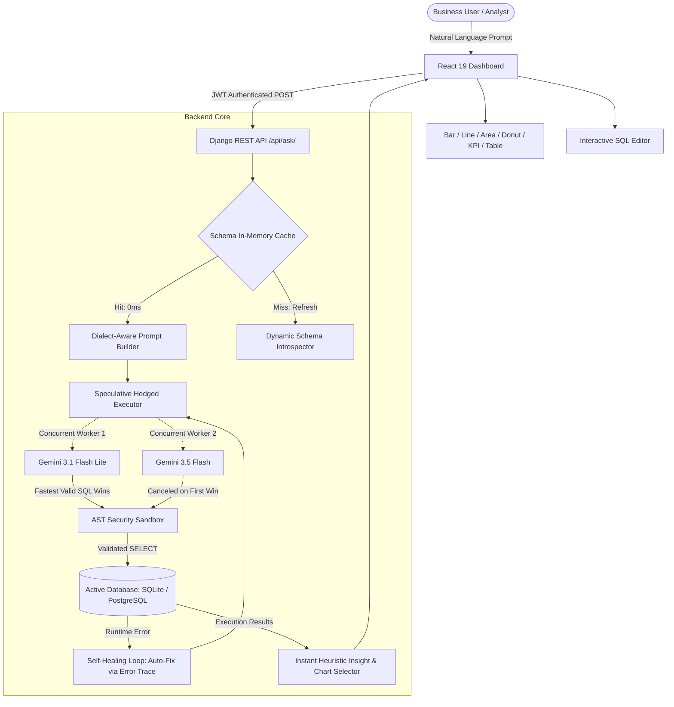

# DataWhisper Enterprise 2.0 🚀

[](https://www.djangoproject.com/)
[](https://react.dev/)
[](https://vitejs.dev/)
[](https://ai.google.dev/)
[](https://tailwindcss.com/)
[](LICENSE)

> **DataWhisper Enterprise** is an AI-powered conversational Business Intelligence (BI) platform that translates natural language questions into accurate, dialect-optimized SQL queries, executes them in a secure sandbox, self-heals syntax errors, and synthesizes executive insights with dynamic data visualizations.

---

## 🌟 Key Features

- **⚡ Sub-Second Natural Language to SQL**: Ask complex business questions in natural English (*"Calculate net profit margin by category"*, *"What is the failure rate of UPI payments?"*). Powered by a speculative hedged GenAI pipeline with persistent connection pooling returning results in **~1.0s**.
- **🛡️ AST-Level Security Sandbox**: Parses SQL syntax trees using `sqlparse` to enforce strictly read-only single `SELECT` statements and whitelist allowed enterprise tables (blocking access to credentials, sessions, and system schemas).
- **🩺 Self-Healing SQL Engine**: Catches database runtime/syntax errors and automatically feeds error tracebacks back into the AI engine to auto-repair queries on the fly without user intervention.
- **🔌 Multi-Database Connectors**: Connect external PostgreSQL or SQLite databases via URI, dynamically introspecting remote schemas and routing analytical queries with read-only transaction isolation.
- **📊 Dynamic Visual Analytics Suite**: Auto-detects optimal visualization types in 0.01ms using rule-based schema heuristics:
  - **KPI Metric Cards**: For single aggregated figures and monetary totals.
  - **Bar Charts**: For discrete categorical comparisons.
  - **Line & Area Charts**: For chronological time-series and cumulative volume trends.
  - **Donut / Pie Charts**: For proportional distributions and categorical market shares.
  - **Interactive Data Table**: Searchable, paginated, and sortable tabular views.
- **💻 Interactive SQL Workbench**: Inspect, edit, and re-run generated SQL queries directly from an integrated monospace editor with millisecond latency telemetry.
- **🧠 Zero-Latency Business Insights (0.01ms)**: Computes deterministic analytical takeaways including category leaders, percentage shares, time-series peaks, and monetary aggregates with zero hallucination.
- **🗺️ Database Schema Explorer**: Visual in-app inspector displaying all available tables, column definitions, foreign keys, and data types.
- **📜 Query History Drawer**: Session-persistent query logs with execution duration, row counts, and one-click re-run.
- **📤 Instant Export Suite**: Export result sets as clean CSV or structured JSON files with a single click.

---

## ⚡ Performance & Latency SLA

DataWhisper 2.0 incorporates an ultra-low latency architecture engineered to minimize AI round-trip times:

| Pipeline Stage | Strategy | Latency |
| :--- | :--- | :--- |
| **Schema Introspection** | In-memory 5-minute TTL cache (`_cached_schema_map`) | **<0.1 ms** |
| **SQL Translation** | Speculative hedged race (`gemini-3.1-flash-lite` ⚔️ `gemini-3.5-flash`) | **~900 - 1100 ms** |
| **AST Security Sandbox** | Single-pass abstract syntax tree inspection | **<1 ms** |
| **Database Execution** | Indexed relational queries on SQLite / PostgreSQL | **1 - 10 ms** |
| **Visualization & Insight** | Deterministic statistical heuristics (no second LLM call) | **<0.1 ms** |
| **Total End-to-End** | Client-to-client roundtrip | **⚡ ~1.02s** |

---

## 🏗️ System Architecture



---

## 📚 Documentation Reference

Detailed technical documentation and guides:
- [Technical Architecture](docs/ARCHITECTURE.md) — Deep dive into backend data flow, security model, and frontend design.
- [REST API Reference](docs/API_DOCUMENTATION.md) — Full endpoint specifications, request payloads, and response schemas.
- [Database Schema Dictionary](docs/DATABASE_SCHEMA.md) — Entity relationships, column definitions, and business domain context.
- [Security Threat Model](docs/SECURITY.md) — AST sandbox enforcement, read-only guarantees, and JWT lifecycle.
- [Production Deployment Guide](docs/DEPLOYMENT_GUIDE.md) — Deploying to Render, Docker, and environment configuration.

---

## 🚀 Quick Start Guide

### Prerequisites
- **Python 3.12+** (tested on 3.12 and 3.14)
- **Node.js 18+** & `npm`
- **Google Gemini API Key** (from [Google AI Studio](https://aistudio.google.com/))

### 1. Clone the Repository
```bash
git clone https://github.com/Manvendrasingh2005/DataWhisper-enterprise.git
cd DataWhisper-enterprise
```

### 2. Backend Setup
```bash
cd backend

# Create and activate virtual environment
python -m venv venv
# On Windows:
.\venv\Scripts\activate
# On Linux/macOS:
source venv/bin/activate

# Install dependencies
pip install -r requirements.txt

# Configure environment variables
cp .env.example .env
# Edit .env and insert your GEMINI_API_KEY and SECRET_KEY

# Run database migrations
python manage.py migrate

# Seed rich enterprise demo database
python manage.py seed_db

# Create an admin user for dashboard access
python manage.py createsuperuser

# Start Django development server
python manage.py runserver
```

### 3. Frontend Setup
```bash
cd ../frontend

# Install dependencies
npm install

# Start Vite development server
npm run dev
```

Visit **`http://localhost:5173`** in your browser, log in with your superuser credentials, and start exploring your data!

---

## ⚙️ Environment Variables

### Backend (`backend/.env`)
| Variable | Description | Default / Example |
| :--- | :--- | :--- |
| `GEMINI_API_KEY` | API Key from Google AI Studio (**Required**) | `AQ.Ab8RN6...` |
| `SECRET_KEY` | Django Secret Key | `django-insecure-your-secret-key` |
| `DATABASE_URL` | Optional PostgreSQL URI (defaults to SQLite) | `sqlite:///db.sqlite3` |
| `RENDER` | Set in production to disable DEBUG mode | *(empty in local dev)* |

### Frontend (`frontend/.env`)
| Variable | Description | Default |
| :--- | :--- | :--- |
| `VITE_API_URL` | Backend REST API Base URL | `http://127.0.0.1:8000` |

---

## 🧪 Testing

The repository includes a comprehensive 11-test suite covering security AST parsing, table whitelisting, schema introspection, and authenticated endpoints:

```bash
cd backend
python manage.py test api
```

Run frontend linting:
```bash
cd frontend
npm run lint
```

---

## 📦 Deployment

DataWhisper includes zero-config deployment configurations:
- **Render**: Connect the repository to Render; it automatically reads [`render.yaml`](render.yaml) to provision a managed PostgreSQL database, Python backend service, and static React frontend.
- **Docker**: Build and run with the provided [`Dockerfile`](backend/Dockerfile) and [`docker-compose.yml`](docker-compose.yml).

---

## 📄 License

This project is licensed under the MIT License - see the [LICENSE](LICENSE) file for details.
