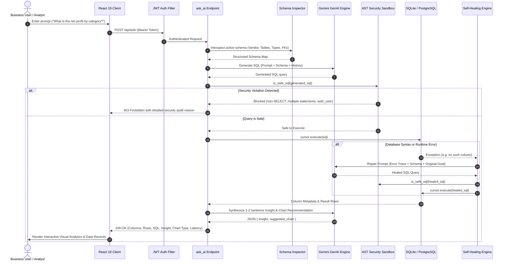

# DataWhisper Enterprise: Architecture & Engineering Guide

This document provides a comprehensive technical overview of the **DataWhisper Enterprise** architecture, covering the Natural Language to SQL translation pipeline, AST security sandbox, self-healing execution loop, and dynamic multi-database routing.

---

## 1. High-Level System Flow

---

## 2. Core Subsystems

### 2.1 Dynamic Schema Introspection (`backend/api/schema_inspector.py`)
Rather than relying on static or hardcoded table definitions, DataWhisper inspects the database in real time:
- Uses Django's `connection.introspection` to dynamically query database metadata.
- Automatically discovers table names, column data types, nullability, and foreign key relations.
- **Dialect Detection**: Identifies whether the active engine is **SQLite**, **PostgreSQL**, or **MySQL**, adjusting date functions and operators accordingly.
- **System Table Filtering**: Automatically excludes Django internal tables (`auth_*`, `django_*`, `sqlite_*`, `pg_*`) to protect private data.

### 2.2 AST-Level Security Sandbox (`backend/api/security.py`)
Traditional regex filters fail to catch obfuscated SQL injections. DataWhisper parses raw queries into an Abstract Syntax Tree (AST) using `sqlparse`:
1. **Single Statement Enforcement**: Strictly verifies `len(parsed) == 1`, blocking query chaining attacks (e.g. `SELECT 1; DROP TABLE users;`).
2. **Command Whitelist**: Rejects any statement whose root DML command is not strictly `'SELECT'`.
3. **Keyword Blacklist**: Blocks destructive keywords (`DROP`, `ALTER`, `TRUNCATE`, `INSERT`, `UPDATE`, `DELETE`, `PRAGMA`, `LOAD_EXTENSION`, `COPY`).
4. **Table Whitelisting**: Traverses token trees following `FROM` and `JOIN` clauses to ensure queries only touch permitted application models, completely preventing access to `auth_user` or system catalogs.

### 2.3 Resilient AI Engine & Self-Healing Loop (`backend/api/ai_engine.py`)
Built on the modern Google GenAI SDK:
- **Multi-Model Priority Cascade**: Prioritizes `gemini-3.5-flash`, `gemini-3.6-flash`, and `gemini-flash-latest` for sub-second query generation.
- **Conversational Memory**: Retains previous question-and-SQL turns, enabling follow-up refinements (*"Now show only the top 5"*, *"Filter to corporate clients"*).
- **Self-Healing Loop**: If the database raises an operational error (e.g., column mismatch), the engine captures the exact traceback, constructs a diagnostic prompt, and requests an auto-corrected query (up to 2 retries).
- **Visualization Heuristic**: Evaluates the shape and cardinality of returned data to suggest the optimal chart type (`metric_card`, `bar_chart`, `line_chart`, `area_chart`, `pie_chart`, or `table`).

### 2.4 External Database Connector (`backend/api/db_connector.py`)
Enables enterprise users to query their own external databases:
- Parses `postgresql://` and `sqlite://` connection strings.
- Enforces strict read-only parameters:
  - **PostgreSQL**: `conn.set_session(readonly=True, autocommit=True)`.
  - **SQLite**: Opens connection with `mode=ro` (read-only filesystem flag).
- Introspects external schemas and routes queries without mutating data.

### 2.5 Relational Data Schema (`backend/api/models.py`)
The bundled enterprise dataset models a multi-national retail & ERP ecosystem:
- **`Supplier`**: Supply chain partners with contact email and country.
- **`User`**: Corporate clients across major global tech hubs (`active` vs `churned`).
- **`Product`**: SKU, category, wholesale cost price, retail selling price, and inventory stock.
- **`Order` & `OrderItem`**: Multi-item purchases with timestamp and status tracking.
- **`Payment`**: Transaction logs across payment gateways (`Credit Card`, `UPI`, `PayPal`, `NetBanking`) with gateway responses (`SUCCESS`, `FAILED`).
- **`InventoryLog`**: Real-time warehouse movement history (`IN` vs `OUT`).

---

## 3. Frontend Architecture (`frontend/src/App.jsx`)

The frontend is built on **React 19** with **Tailwind CSS v4** and **Recharts**:
- **State Management**: Zero bloated external dependencies; uses clean React hooks (`useState`, `useEffect`, `useMemo`) for instant state updates.
- **Dynamic Chart Rendering**: Automatically adapts Recharts components based on AI suggestion or user manual override.
- **Interactive SQL Workbench**: Collapsible monospace editor allowing direct SQL edits and live re-runs against `/api/execute-raw/`.
- **Query History**: LocalStorage-persisted query drawer tracking duration, row counts, and one-click replay.
- **Client-Side Exporting**: Instant CSV Blob generation and JSON serialization without server overhead.
